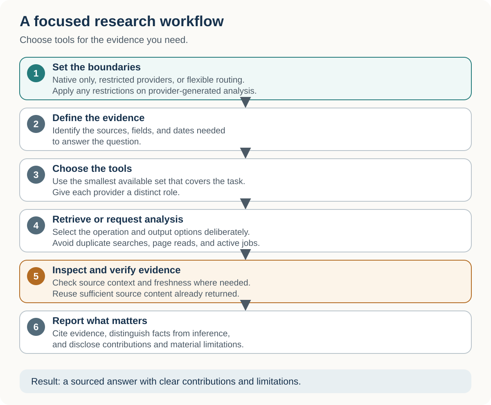
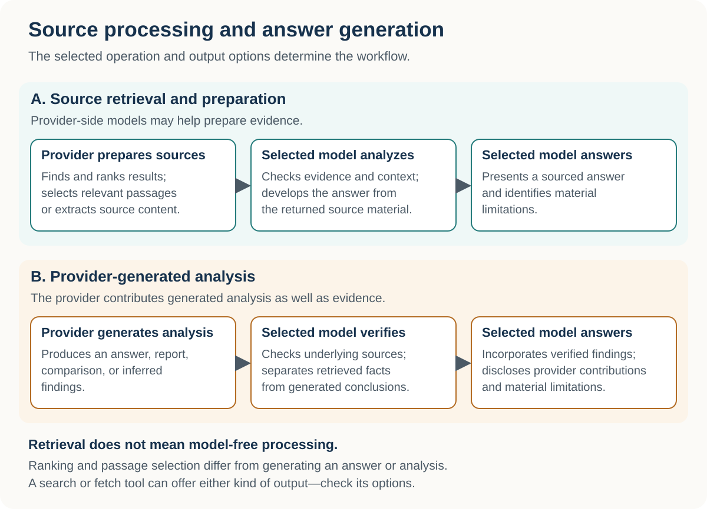

# Choosing research tools for your AI assistant

*A practical guide to pairing your favorite AI assistant with dedicated search and retrieval tools.*

[← Start with the introduction](../README.md)

Flagship AI assistants already ship with capable built-in web search for quick lookups. Dedicated research providers become valuable when you need wider market coverage, structured company or registry records, stricter date and domain controls, or better search inside coding agents and lower-cost workspaces.

Start with one provider that fits your app and question, verify that it actually ran, and inspect the links it returns. You do not need the optional routing skill to use any provider.

**Guide refreshed:** 28 November 2026. Check each provider's linked documentation for live schemas and current rates.

## How the guide is organized

Pick the page that matches where you are:

| Page | Use it when you want to… |
| --- | --- |
| [**Choosing providers**](choosing-providers.md) | Compare what Exa, Parallel, Keenable, Octen, Perplexity, and authenticated X each do well, without vendor hype or rankings. |
| [**Connecting providers**](connecting-providers.md) | Set up a free provider in ChatGPT, Claude, Cursor, Command Code, OpenCode, Grok Bot, or a terminal agent, plus optional advanced MCP configuration. |
| [**Research prompts**](research-prompts.md) | Copy practical prompts for everyday research, provider-specific tasks, or stricter audit boundaries. |
| [**Costs and access**](costs.md) | Compare free recurring tiers, keyless endpoints, and low-cost regional workspace combinations. |

## The simple 3-step workflow

1. **Keep the assistant you already use.** Your application (ChatGPT, Claude, Cursor, Grok Bot, Claude Code, Codex) and model stay the same.
2. **Connect one provider for the gap you have.** Start with a free or keyless route such as Exa, Parallel, or Keenable. Add another provider only when a distinct capability calls for it.
3. **Inspect the evidence, not just the prose.** Open one or two returned links, check dates and qualifications, and confirm the connected provider actually handled the search.



### Source retrieval vs. provider-written answers

Most providers offer two distinct kinds of operations:

- **Search and fetch (retrieval):** The provider finds relevant pages or structured records and hands the evidence to your chosen model to read and write the answer. This is the right default when you want your own assistant doing the reasoning.
- **Agent or research modes (provider-side synthesis):** The provider runs its own internal model and workflow to produce a report, structured table, or cited answer (for example, Exa Agent, Parallel `web_research` / Deep Research, or Perplexity Ask / Reason / Research). These can be powerful for deep multi-step work, but they use the provider's model rather than yours and often carry higher per-run charges.



Read the full breakdown in [Choosing providers](choosing-providers.md#retrieval-and-provider-side-synthesis).

## Try a short prompt first

Once one provider is connected, you do not need a complicated prompt. Start with a plain request that names the tool and asks for verifiable links:

```text
Use [my connected search provider] to answer this question: [YOUR QUESTION]

Prefer primary and official sources. Link the exact pages you relied on, keep reported facts separate from interpretation, and tell me if anything important could not be verified.
```

For ready-to-paste examples across everyday topics, see the [Prompt library](research-prompts.md#four-starters) or the introduction's [four domain examples](../README.md#examples).

## Add the optional routing skill when you use more than one tool

Connecting a provider gives your assistant access to it. The optional **[multi-provider-research](https://github.com/goolamabbas/multi-provider-research)** skill adds reusable instructions for coding agents and skill-capable apps so you do not have to repeat routing rules in every prompt. It helps an assistant pick the smallest useful set of connected providers, avoid duplicate searches, check primary sources, and flag real gaps.

It is an instruction package only: it does not install providers, supply API keys, or pay for usage.

In a coding agent with local file access, paste:

```text
Install the multi-provider-research skill by following https://raw.githubusercontent.com/goolamabbas/multi-provider-research/main/install.md
```

Once installed, start a fresh session and ask:

```text
Use the multi-provider-research skill.

Research question: [YOUR QUESTION]
```

See the [GitHub repository](https://github.com/goolamabbas/multi-provider-research) for manual installation and release notes.

## Worked examples

Real runs help show what connected research looks like in practice, including where tools overlap and where they fall short:

- **[28 November 2026 market-map test](../README.md#idea):** Side-by-side comparison of ChatGPT built-in search (GPT-6.2 Astra) vs. one free-tier Exa company search call on UK AI compliance and accounting startups.
- **[Controlled A/B/C test: OpenCode + open-weight model + v0.12.0](https://goolamabbas.github.io/separate-intelligence-and-search/guide/india-saas-case-study/):** Same `DeepSeek-V4.1-Flash-1017-Fast` model across bare, OpenCode native `websearch`, and Parallel + Exa MCP with `multi-provider-research` `v0.12.0` on an India B2B SaaS brief ($0.011 model cost, exact tool logs, and why MCP beat native `websearch`).

## Continue reading

- **Compare the five providers:** [Choosing an external research provider](choosing-providers.md)
- **Set one up in your app:** [Installing and testing external research providers](connecting-providers.md)
- **Copy a prompt:** [Research prompt cookbook](research-prompts.md)
- **Compare free tiers and budgets:** [Plan your research budget](https://goolamabbas.github.io/separate-intelligence-and-search/guide/costs/)
